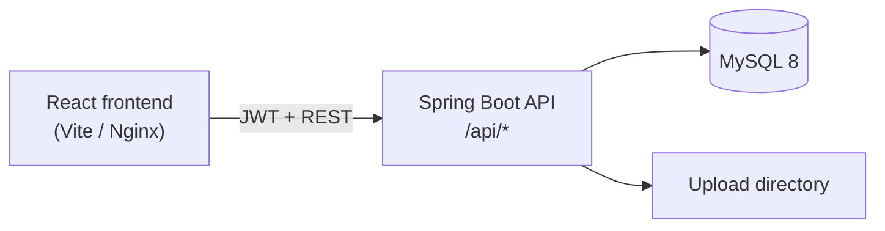

# CampusConnect

Classroom management web app (Google Classroom–style) for an MCA final mini project.

Monorepo:

- `backend` — Spring Boot 3, Java 21, MySQL 8, JWT auth, Flyway
- `frontend` — React + Vite + TypeScript + Tailwind CSS

## Features

### Phase 1 — Auth & classes

- Register / login / refresh / logout (JWT access 15 min + refresh 7 days)
- Teachers create, edit, archive classes and regenerate class codes
- Students join via class code
- Dashboard, class shell (Stream / Classwork / Materials / People / Grades), profile

### Phase 2 — Classwork

- Stream: announcements, pin/unpin, comments, attachments
- Topics; study materials with upload/download (max 25 MB)
- Assignments, submissions, grading and return
- Student dashboard To-do (upcoming and missing)

### Phase 3 — Notifications, grades, admin & polish

- In-app notifications (announcement, assignment, material, graded, due-tomorrow job)
- Gradebook matrix, student grade summary, CSV/Excel export, class analytics charts
- Calendar month view of due dates across classes
- Global search (Ctrl+K)
- Admin dashboard (users, roles, activate/deactivate, all classes, storage stats)
- Security: login rate limit, lockout after 5 failures, change password, forgot/reset password
- Dark mode (same accent `#1A73E8`)

## Architecture



## API overview

| Area | Base path | Notes |
|------|-----------|--------|
| Auth | `/api/auth` | register, login, refresh, logout, me, change/forgot/reset password |
| Classrooms | `/api/classrooms` | CRUD, join, people |
| Stream | `/api/classrooms/{id}/announcements` | posts, pin, comments |
| Topics / materials | `/api/classrooms/{id}/topics`, `.../materials` | |
| Assignments | `/api/classrooms/{id}/assignments` | submit, unsubmit, grade |
| Files | `/api/classrooms/{id}/files`, `/api/files/{id}/download` | membership-checked |
| Notifications | `/api/notifications` | list, unread count, mark read |
| Grades | `/api/classrooms/{id}/grades` | gradebook, me, analytics, export |
| Calendar | `/api/calendar` | `?year=&month=` |
| Search | `/api/search?q=` | classes, assignments, materials |
| Admin | `/api/admin` | stats, users, classrooms |
| To-do | `/api/me/todo` | student upcoming / missing |

Swagger UI: http://localhost:8080/swagger-ui.html

## Prerequisites

- Java 21+ (`JAVA_HOME` must point to JDK 21)
- Maven 3.9+ (or `backend/mvnw`)
- Node.js 20+
- MySQL 8  
  **or** Docker Desktop for Compose

## Setup (local)

### 1. Database

```sql
CREATE DATABASE IF NOT EXISTS campusconnect CHARACTER SET utf8mb4 COLLATE utf8mb4_unicode_ci;
```

| Variable | Default |
|----------|---------|
| `DB_HOST` | `localhost` |
| `DB_PORT` | `3306` |
| `DB_NAME` | `campusconnect` |
| `DB_USER` | `root` |
| `DB_PASSWORD` | `root` |
| `JWT_SECRET` | (dev secret in `application.yml`) |
| `UPLOAD_DIR` | `./uploads` |
| `FRONTEND_URL` | `http://localhost:5173` |

### 2. Backend

```bash
cd backend
.\mvnw.cmd spring-boot:run "-Dspring-boot.run.profiles=dev"
```

Flyway applies `V1`–`V5` on startup. The `dev` profile copies sample material files into `UPLOAD_DIR`.

### Database migrations

- Schema changes go only through Flyway scripts under `backend/src/main/resources/db/migration/` (`V1__…`, `V2__…`, …). Do not use `ddl-auto=update`.
- **Never edit a migration that has already been committed or applied.** Put fixes and later schema work in a new version (for example `V6__…`).
- Exception note for `V5__cover_banner_colors.sql`: the first committed script used a correlated `UPDATE` that fails on some MySQL/MariaDB builds (including older XAMPP). The file was rewritten once to a portable form. If your database already applied the original `V5` and Flyway reports a **checksum mismatch** after you pull this change, repair once, then restart the app:
  ```sql
  -- Option A: Flyway CLI → flyway repair
  -- Option B: clear the V5 history row (safe here; V5 only remaps banner_color values)
  DELETE FROM flyway_schema_history WHERE version = '5';
  ```
  Fresh databases simply run the current `V5` and need no repair.

### 3. Frontend

```bash
cd frontend
npm install
npm run dev
```

App: http://localhost:5173

### 4. Seed data (optional demo content)

```bash
mysql -u root -p campusconnect < backend/src/main/resources/db/seed/seed_phase1.sql
mysql -u root -p campusconnect < backend/src/main/resources/db/seed/seed_phase2.sql
mysql -u root -p campusconnect < backend/src/main/resources/db/seed/seed_phase3.sql
```

Then restart the backend with the `dev` profile so seed PDFs/images are linked on disk.

## Docker Compose

```bash
docker compose up --build
```

| Service | URL |
|---------|-----|
| Frontend | http://localhost:3000 |
| Backend API | http://localhost:8080 |
| MySQL | localhost:3306 |

Nginx proxies `/api` from the frontend container to the backend. After first boot, load seed SQL into the MySQL container if you want demo data:

```bash
docker exec -i campusconnect-mysql mysql -uroot -proot campusconnect < backend/src/main/resources/db/seed/seed_phase1.sql
docker exec -i campusconnect-mysql mysql -uroot -proot campusconnect < backend/src/main/resources/db/seed/seed_phase2.sql
docker exec -i campusconnect-mysql mysql -uroot -proot campusconnect < backend/src/main/resources/db/seed/seed_phase3.sql
docker restart campusconnect-backend
```

## Demo login credentials

All seeded passwords: **`Password@123`**

| Role | Email |
|------|--------|
| Admin | `admin@campusconnect.edu` |
| Teacher | `ananya.krishnan@college.edu` |
| Student | `aarav.mehta@student.college.edu` |

## Screenshots

Add screenshots under `docs/screenshots/` and link them here for your project report:

- `docs/screenshots/dashboard.png` — class grid / to-do
- `docs/screenshots/stream.png` — class stream
- `docs/screenshots/gradebook.png` — teacher gradebook
- `docs/screenshots/calendar.png` — due-date calendar
- `docs/screenshots/admin.png` — admin stats

*(Placeholders — capture from a running instance before submission.)*

## Tests

```bash
cd backend
.\mvnw.cmd test
```

Uses JUnit 5 + Mockito + H2 for auth, classroom, notification, grade, and security flows.

## Project structure

```
Campus-Connect/
  backend/          Spring Boot API
  frontend/         React SPA
  docker-compose.yml
  scripts/          seed file generator
  .cursor/rules/    Cursor project rules
```
