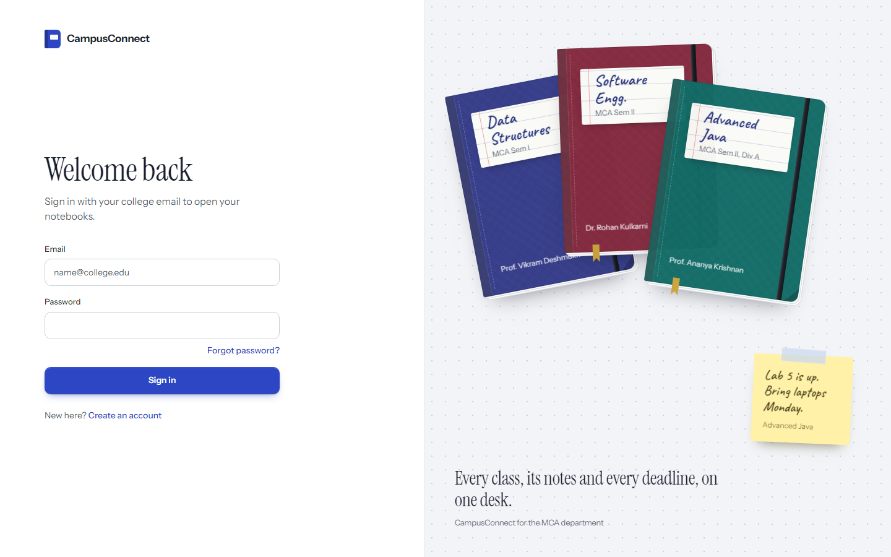
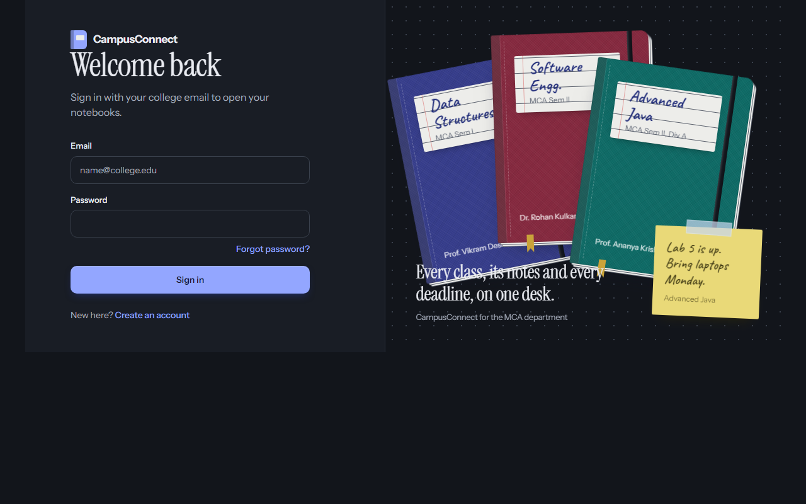
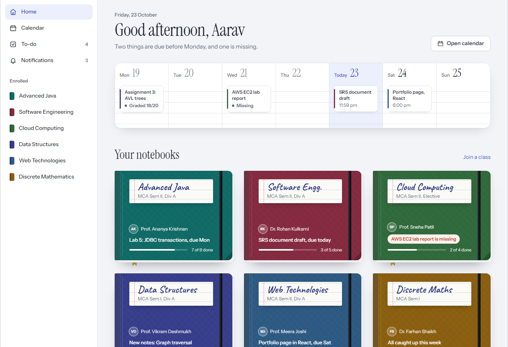
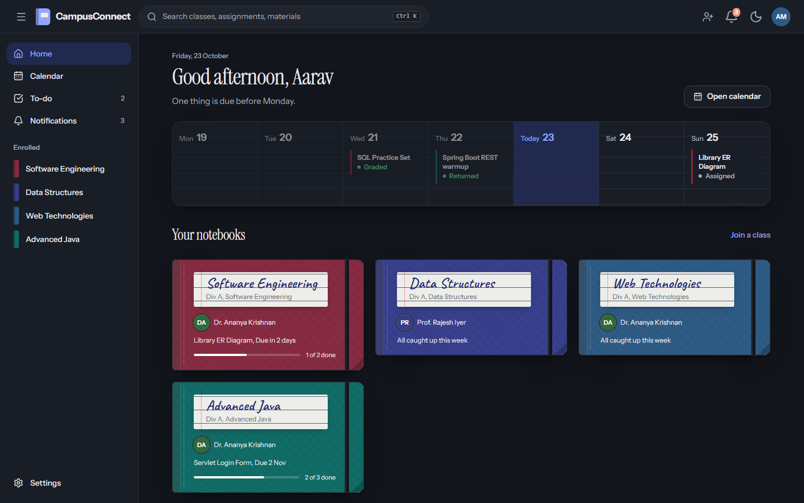
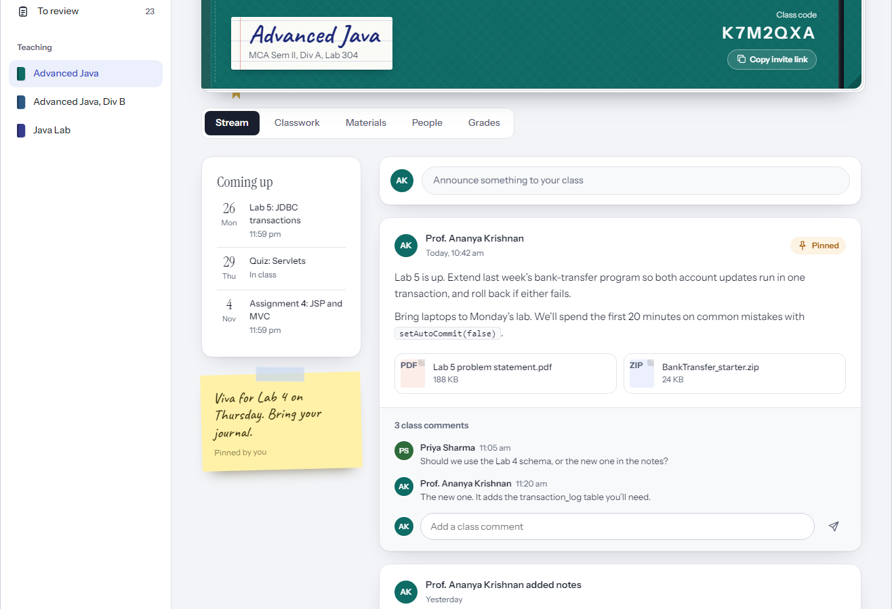
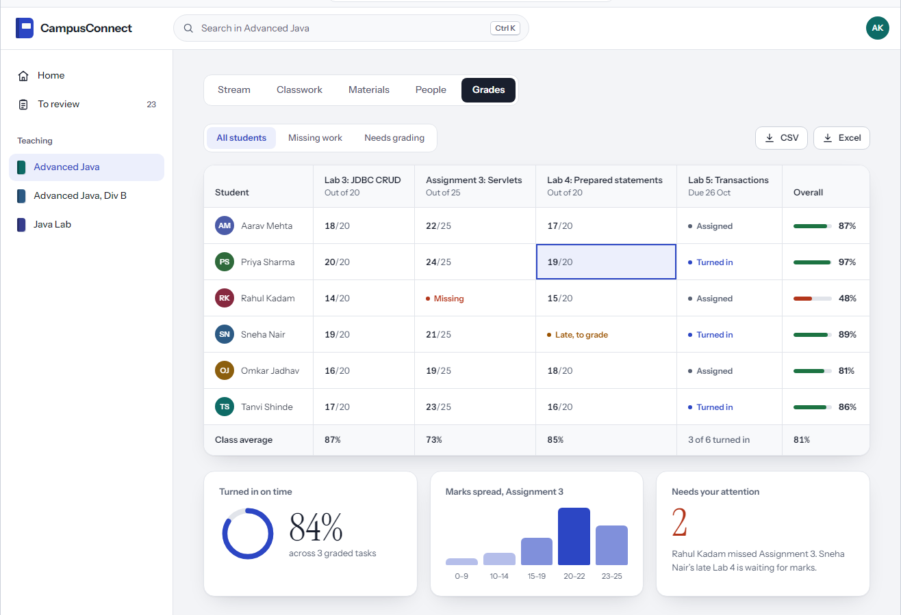
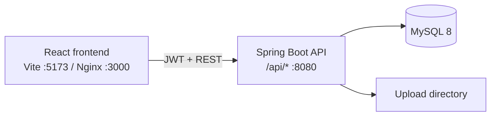

# CampusConnect

**Classroom management for the modern campus** — a Google Classroom–style web app built as an MCA final mini project. Teachers run classes; students join with a code; everyone stays on stream, classwork, materials, grades, and due dates.

| Layer | Stack |
|-------|--------|
| **Frontend** | React 19 · Vite · TypeScript · Tailwind CSS · TanStack Query |
| **Backend** | Java 21 · Spring Boot 3 · Spring Security (JWT) · Flyway |
| **Data** | MySQL 8 · file uploads on disk |

```
Campus-Connect/
├── backend/     Spring Boot REST API (:8080)
├── frontend/    React SPA (Vite :5173)
├── docs/        Design reference + screenshots
├── scripts/     Seed helpers & screenshot capture
└── docker-compose.yml
```

---

## Preview

| Light | Dark |
|:-----:|:----:|
|  |  |
|  |  |
|  |  |

More captures (calendar, notifications, admin, mobile to-do): [`docs/screenshots/`](docs/screenshots/).

---

## Features

**Auth & classes** — Register / login / refresh / logout (JWT). Teachers create and archive classes; students join with a class code. Notebook-style covers, profile, dark mode.

**Classwork** — Stream (announcements, pin, comments), topics, materials (upload/download, 25 MB), assignments, submissions, grading. Student to-do (upcoming & missing).

**Notifications & grades** — In-app alerts, gradebook matrix, CSV/Excel export, analytics charts, calendar of due dates, global search (`Ctrl+K`).

**Admin & security** — User/role admin, activate/deactivate, storage stats. Login rate limit, lockout after 5 failures, change / forgot / reset password.

---

## Architecture



| Surface | URL (local) |
|---------|-------------|
| App (Vite) | http://localhost:5173 |
| App (Docker / Nginx) | http://localhost:3000 |
| API | http://localhost:8080 |
| Swagger UI | http://localhost:8080/swagger-ui.html |

---

## Prerequisites

Install these before the first run:

| Tool | Version | Notes |
|------|---------|--------|
| **Git** | latest | Clone the repo |
| **Java JDK** | **21+** | `JAVA_HOME` must point to JDK 21 (not 17) |
| **Node.js** | **20+** | Includes `npm` |
| **MySQL** | **8.x** | Or MariaDB 10.4+ / XAMPP MySQL |
| **Docker Desktop** *(optional)* | latest | One-command full stack |

Verify:

```bash
java -version          # openjdk 21.x
node -v                # v20+
mysql --version        # 8.x  (or use XAMPP Control Panel)
```

---

## Quick start (choose one)

### Option A — Docker (fastest)

```bash
git clone <YOUR_REPO_URL> Campus-Connect
cd Campus-Connect
docker compose up --build
```

| Service | URL |
|---------|-----|
| Frontend | http://localhost:3000 |
| Backend | http://localhost:8080 |
| MySQL | `localhost:3306` · user `root` · password `root` · db `campusconnect` |

Load demo data (optional):

```bash
docker exec -i campusconnect-mysql mysql -uroot -proot campusconnect < backend/src/main/resources/db/seed/seed_phase1.sql
docker exec -i campusconnect-mysql mysql -uroot -proot campusconnect < backend/src/main/resources/db/seed/seed_phase2.sql
docker exec -i campusconnect-mysql mysql -uroot -proot campusconnect < backend/src/main/resources/db/seed/seed_phase3.sql
docker restart campusconnect-backend
```

Stop: `docker compose down`

---

### Option B — Local (Windows / macOS / Linux)

#### 1. Clone

```bash
git clone <YOUR_REPO_URL> Campus-Connect
cd Campus-Connect
```

#### 2. Database

Create a schema (pick a name and stick to it):

```sql
CREATE DATABASE IF NOT EXISTS campusconnect_app
  CHARACTER SET utf8mb4 COLLATE utf8mb4_unicode_ci;
```

| Your MySQL setup | Profiles / password |
|------------------|---------------------|
| **XAMPP** (empty root password) | Use Spring profiles `local,dev` (see commands below). DB name in `application-local.yml` defaults to `campusconnect_app`. |
| **MySQL with password `root`** | Use profile `dev` and defaults from `application.yml` (`DB_PASSWORD=root`, db `campusconnect`). |

#### 3. Backend

**Windows (PowerShell) — XAMPP / empty password:**

```powershell
cd backend
$env:JAVA_HOME = "C:\Program Files\Microsoft\jdk-21.0.10.7-hotspot"   # adjust to your JDK 21 path
$env:Path = "$env:JAVA_HOME\bin;$env:Path"
$env:SPRING_PROFILES_ACTIVE = "local,dev"
.\mvnw.cmd spring-boot:run
```

**Windows — MySQL password `root`:**

```powershell
cd backend
$env:JAVA_HOME = "C:\Program Files\Microsoft\jdk-21.0.10.7-hotspot"
$env:Path = "$env:JAVA_HOME\bin;$env:Path"
.\mvnw.cmd spring-boot:run "-Dspring-boot.run.profiles=dev"
```

**macOS / Linux:**

```bash
cd backend
export JAVA_HOME=$(/usr/libexec/java_home -v 21)   # macOS; on Linux set to your JDK 21 path
export SPRING_PROFILES_ACTIVE=local,dev            # or just "dev" if DB password is root
./mvnw spring-boot:run
```

Flyway applies migrations **V1–V5** on first start. Wait until you see:

`Started CampusConnectApplication`

#### 4. Frontend (new terminal)

```bash
cd frontend
npm install
npm run dev
```

Open **http://localhost:5173**

#### 5. Seed demo data (optional)

Run against the **same database** the backend uses:

```bash
# Adjust -p / database name for your setup
mysql -u root campusconnect_app < backend/src/main/resources/db/seed/seed_phase1.sql
mysql -u root campusconnect_app < backend/src/main/resources/db/seed/seed_phase2.sql
mysql -u root campusconnect_app < backend/src/main/resources/db/seed/seed_phase3.sql
```

XAMPP (GUI / CLI with empty password):

```bash
# Windows example
"C:\xampp\mysql\bin\mysql.exe" -u root campusconnect_app < backend\src\main\resources\db\seed\seed_phase1.sql
"C:\xampp\mysql\bin\mysql.exe" -u root campusconnect_app < backend\src\main\resources\db\seed\seed_phase2.sql
"C:\xampp\mysql\bin\mysql.exe" -u root campusconnect_app < backend\src\main\resources\db\seed\seed_phase3.sql
```

Then **restart the backend** with the `dev` profile so sample material files are linked under `UPLOAD_DIR`.

---

## Run commands cheat sheet

Keep these two terminals open while developing.

| Step | Command |
|------|---------|
| Backend (XAMPP) | `cd backend` → `.\mvnw.cmd spring-boot:run` with `SPRING_PROFILES_ACTIVE=local,dev` |
| Backend (password `root`) | `cd backend` → `.\mvnw.cmd spring-boot:run "-Dspring-boot.run.profiles=dev"` |
| Frontend | `cd frontend` → `npm install` (once) → `npm run dev` |
| Backend tests | `cd backend` → `.\mvnw.cmd test` |
| Frontend build | `cd frontend` → `npm run build` |
| Docker up | `docker compose up --build` |
| Docker down | `docker compose down` |
| API docs | http://localhost:8080/swagger-ui.html |

---

## Demo accounts

After seeding, all passwords are **`Password@123`**.

| Role | Email |
|------|--------|
| Admin | `admin@campusconnect.edu` |
| Teacher | `ananya.krishnan@college.edu` |
| Student | `aarav.mehta@student.college.edu` |

---

## Environment variables

| Variable | Default | Purpose |
|----------|---------|---------|
| `DB_HOST` | `localhost` | MySQL host |
| `DB_PORT` | `3306` | MySQL port |
| `DB_NAME` | `campusconnect` | Schema name (`campusconnect_app` when using `local` profile) |
| `DB_USER` | `root` | DB user |
| `DB_PASSWORD` | `root` | DB password (empty string with `local` profile / XAMPP) |
| `JWT_SECRET` | (dev value in `application.yml`) | Must be long enough for HS256 |
| `UPLOAD_DIR` | `./uploads` | File storage root |
| `FRONTEND_URL` | `http://localhost:5173` | Used in password-reset links |
| `CORS_ORIGINS` | Vite + Docker origins | Comma-separated allowed origins |
| `SPRING_PROFILES_ACTIVE` | — | e.g. `dev`, `local,dev` |

---

## Database migrations

- Schema changes go **only** through Flyway scripts under `backend/src/main/resources/db/migration/` (`V1__…`, `V2__…`, …). Do **not** use `ddl-auto=update`.
- **Never edit a migration that has already been committed or applied.** Put fixes and later schema work in a new version (for example `V6__…`).
- **V5 note:** `V5__cover_banner_colors.sql` was rewritten once for MySQL/MariaDB portability. If Flyway reports a **checksum mismatch** after you pull:

  ```sql
  -- Option A: Flyway CLI → flyway repair
  -- Option B: clear the V5 history row (safe; V5 only remaps banner_color values)
  DELETE FROM flyway_schema_history WHERE version = '5';
  ```

  Then restart the app. Fresh databases run the current `V5` and need no repair.

---

## API overview

| Area | Base path |
|------|-----------|
| Auth | `/api/auth` |
| Classrooms | `/api/classrooms` |
| Stream | `/api/classrooms/{id}/announcements` |
| Topics / materials | `/api/classrooms/{id}/topics`, `.../materials` |
| Assignments | `/api/classrooms/{id}/assignments` |
| Files | `/api/classrooms/{id}/files`, `/api/files/{id}/download` |
| Notifications | `/api/notifications` |
| Grades | `/api/classrooms/{id}/grades` |
| Calendar | `/api/calendar` |
| Search | `/api/search?q=` |
| Admin | `/api/admin` |
| To-do | `/api/me/todo` |

Interactive docs: **http://localhost:8080/swagger-ui.html**

---

## Project structure

```
Campus-Connect/
├── backend/
│   ├── src/main/java/com/campusconnect/   # config, security, controllers, services…
│   ├── src/main/resources/
│   │   ├── application.yml               # defaults
│   │   ├── application-local.yml         # XAMPP / empty DB password
│   │   ├── application-dev.yml           # seed file linking
│   │   └── db/migration/                 # Flyway V1–V5
│   └── src/test/                         # JUnit 5 + Mockito + H2
├── frontend/
│   └── src/                              # api, components, features, pages, routes
├── docs/
│   ├── design/                           # UI design reference HTML
│   └── screenshots/                      # light & dark captures
├── scripts/                              # seed / screenshot helpers
├── .cursor/rules/                        # Cursor project rules
└── docker-compose.yml
```

---

## Tests

```bash
cd backend
./mvnw test          # macOS / Linux
.\mvnw.cmd test      # Windows
```

Covers auth, classroom, notification, grade, and security flows (JUnit 5 + Mockito + H2).

---

## Troubleshooting

| Symptom | Fix |
|---------|-----|
| `UnsupportedClassVersionError` / class file 65.0 | Use **JDK 21**. Set `JAVA_HOME` to JDK 21 (not 17). |
| `Access denied for user 'root'@'localhost' (using password: YES)` | XAMPP: activate profile **`local`** (empty password). Or set `DB_PASSWORD` to your real password. |
| Flyway checksum mismatch on V5 | Run the `DELETE` / `flyway repair` steps under [Database migrations](#database-migrations), then restart. |
| Frontend loads but API calls fail | Backend must be on **:8080**. Check CORS / `FRONTEND_URL`. |
| Port 8080 or 5173 already in use | Stop the other process, or change the port in config. |
| Seed logins fail | Confirm seed SQL ran on the **same** database the backend uses; password is `Password@123`. |

---

## Master prompt for AI agents

Copy everything inside the box below into **Cursor**, **Antigravity**, **Claude Code**, **Windsurf**, or any coding agent in this repo. The agent should set up the machine end-to-end so you only start (or restart) the servers.

````md
# CampusConnect — full local setup (agent instructions)

You are setting up the CampusConnect monorepo on this developer’s laptop so the app runs locally with zero guesswork. Do the work yourself; do not only print instructions unless a step needs a GUI (e.g. installing Docker Desktop).

## Goals
1. Detect OS, Java, Node, MySQL/XAMPP, and Docker availability.
2. Ensure JDK **21** is used (`JAVA_HOME` → JDK 21). If only JDK 17 is default, locate JDK 21 or tell the user exactly what to install.
3. Ensure Node **20+** and `npm` work.
4. Ensure MySQL is reachable. Prefer existing XAMPP MySQL on Windows if present (often empty root password). Otherwise use local MySQL 8 or offer `docker compose` for MySQL/full stack.
5. Create database `campusconnect_app` (utf8mb4) if missing when using local/XAMPP profile; or `campusconnect` when using default `dev` + password `root`.
6. Start **backend** (Spring Boot, profiles `local,dev` for empty DB password, or `dev` for password `root`) on port **8080**. Wait until `Started CampusConnectApplication`.
7. In another process, `npm install` in `frontend/` if needed, then `npm run dev` on port **5173**.
8. Optionally load seed SQL in order: `seed_phase1.sql`, `seed_phase2.sql`, `seed_phase3.sql` from `backend/src/main/resources/db/seed/` into the **same** DB the backend uses, then restart backend with `dev` so upload samples link.
9. Verify http://localhost:5173 and http://localhost:8080/swagger-ui.html (or `/v3/api-docs`) return success.
10. Report: URLs, which profile/DB was used, demo logins, and any step the human must do manually.

## Hard rules from this repo
- Never edit applied Flyway migrations. Migrations live in `backend/src/main/resources/db/migration/`. If V5 checksum mismatch: `DELETE FROM flyway_schema_history WHERE version = '5';` then restart (or `flyway repair`).
- Follow `.cursor/rules/campusconnect.mdc` for stack and design conventions.
- Do not commit secrets. Do not force-push. Do not change git config.
- Prefer fixing environment/config over rewriting application code unless something is broken.

## Key paths
- Backend: `backend/` · wrapper: `mvnw` / `mvnw.cmd`
- Frontend: `frontend/` · `npm run dev`
- Local empty-password config: `backend/src/main/resources/application-local.yml`
- Docker: `docker compose up --build` → app http://localhost:3000 , API :8080

## Demo logins (after seed)
Password for all: `Password@123`
- Admin: `admin@campusconnect.edu`
- Teacher: `ananya.krishnan@college.edu`
- Student: `aarav.mehta@student.college.edu`

## Windows XAMPP example (agent should adapt paths)
```powershell
# MySQL via XAMPP already running
& "C:\xampp\mysql\bin\mysql.exe" -u root -e "CREATE DATABASE IF NOT EXISTS campusconnect_app CHARACTER SET utf8mb4 COLLATE utf8mb4_unicode_ci;"

cd backend
$env:JAVA_HOME = "<path-to-jdk-21>"
$env:Path = "$env:JAVA_HOME\bin;$env:Path"
$env:SPRING_PROFILES_ACTIVE = "local,dev"
.\mvnw.cmd spring-boot:run

# new terminal
cd frontend
npm install
npm run dev
```

Execute now: inspect the machine, fix blockers, start MySQL if needed, start backend + frontend, optionally seed, and confirm the stack is healthy.
````

---

## License & academic use

Built as an **MCA final mini project**. Use and extend for learning, demos, and viva preparation. Replace `<YOUR_REPO_URL>` above with your Git remote when you share the repo.
